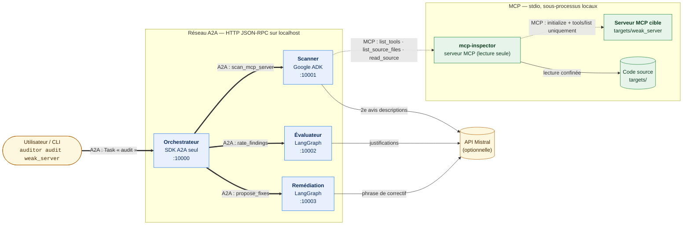
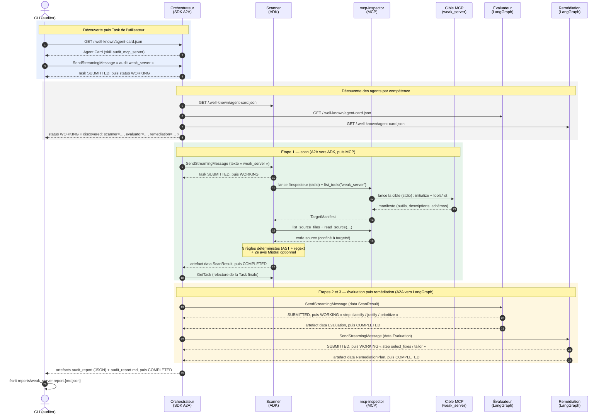
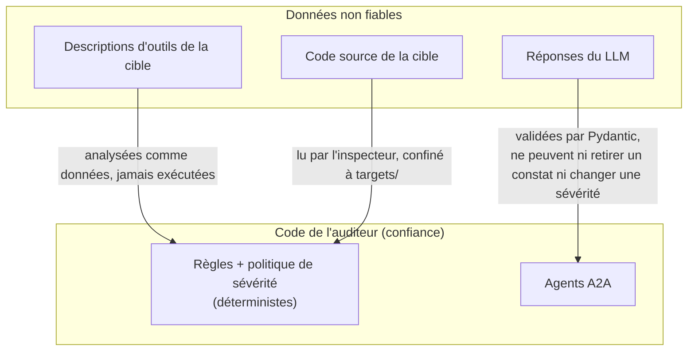

# Architecture

Ce document décrit comment les composants de MCP Security Auditor communiquent.
Deux protocoles coexistent, avec des rôles distincts :

- **A2A** (Agent2Agent) relie des **agents** autonomes entre eux : HTTP + JSON-RPC,
  découverte par Agent Card, travail suivi sous forme de **Task** avec cycle de vie.
- **MCP** (Model Context Protocol) relie **un agent à ses outils** : ici en stdio,
  entre le Scanner et le serveur `mcp-inspector`, puis entre l'inspecteur et la cible.

Les choix détaillés sont justifiés dans [DECISIONS.md](DECISIONS.md) (références `Dxx`).

---

## 1. Vue d'ensemble

**Lecture du schéma.** Les flèches épaisses (`==>`) sont des échanges **A2A** :
l'orchestrateur délègue chaque étape à un agent choisi par sa compétence, quel
que soit son framework (ADK pour le Scanner, LangGraph pour l'Évaluateur et la
Remédiation). Les flèches pointillées (`-.->`) sont des échanges **MCP** : le
Scanner n'accède jamais au disque, il appelle les outils en lecture seule de
`mcp-inspector`, qui lui-même ne fait qu'**une** chose avec la cible : lui
demander son manifeste (`tools/list`). Aucun outil de la cible n'est appelé.
Les flèches fines vers Mistral sont optionnelles : sans clé (ou avec
`--offline`), tout fonctionne avec des gabarits, et les constats comme les
sévérités restent identiques, car ils viennent de règles déterministes (D2, D13).

| Composant | Framework | Exposé via | Code |
|---|---|---|---|
| Orchestrateur | aucun (SDK A2A) | `AgentExecutor` dédié | [orchestrator/](../src/auditor/agents/orchestrator/) |
| Scanner | Google ADK (`BaseAgent` + sous-agent `LlmAgent`) | `to_a2a` d'ADK | [scanner/](../src/auditor/agents/scanner/) |
| Évaluateur | LangGraph (`StateGraph`) | `LangGraphA2AExecutor` | [evaluator/](../src/auditor/agents/evaluator/) |
| Remédiation | LangGraph (`StateGraph`) | `LangGraphA2AExecutor` | [remediation/](../src/auditor/agents/remediation/) |
| mcp-inspector | SDK MCP (`MCPServer`) | stdio | [mcp_inspector/](../src/auditor/mcp_inspector/) |

---

## 2. Déroulé d'un audit complet

**Lecture du schéma.** Chaque échange A2A suit le même motif : **découverte**
(lecture de l'Agent Card), **message** qui crée une **Task**, mises à jour
d'état en streaming (`SUBMITTED → WORKING → COMPLETED`), **artefact** contenant
le résultat, puis relecture de la Task finale avec `GetTask`. Les états
d'échec existent aussi : une entrée invalide donne `REJECTED`, une panne
`FAILED`, et un échec délégué fait échouer la Task de l'orchestrateur avec un
message qui nomme l'agent fautif (D12, D17). Les messages `WORKING`
intermédiaires (« step classify done »…) sont ce qui permet à la CLI d'afficher
la progression en direct. Les données circulent en **parties `data`** (JSON
structuré) et sont revalidées par Pydantic à chaque réception (D10, D16).

---

## 3. Frontières de confiance

**Lecture du schéma.** Un auditeur de tool poisoning manipule par définition
des textes écrits pour tromper un LLM. Trois règles en découlent :
1. les descriptions et le code de la cible sont des **données** : seules des
   règles déterministes en tirent des constats ;
2. l'argument `path` des outils de l'inspecteur est traité comme hostile
   (confinement, liste blanche d'extensions, taille maximale, D4) ;
3. le LLM peut **ajouter** un constat (étiqueté `detector="llm"`) ou rédiger du
   texte, mais jamais retirer un constat, changer une sévérité ou fournir le
   code d'un correctif (D6, D13, D14).
